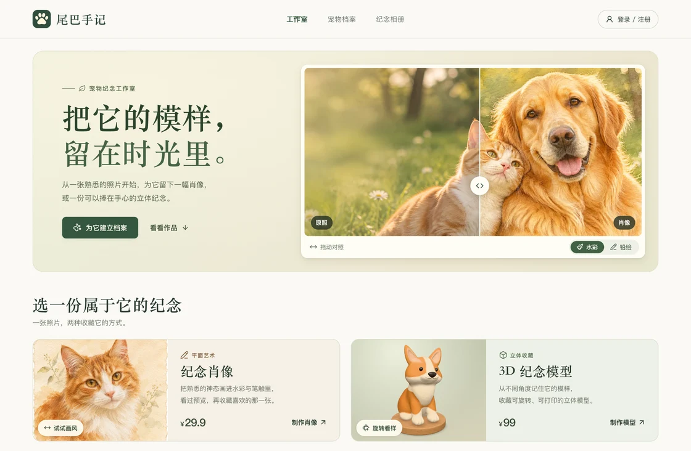

# 尾巴手记

为宠物主人制作私有档案、纪念肖像和 3D 模型的中文网站。一个应用提供用户端、管理后台、API 和可恢复的生成任务。前端使用 React、TypeScript 与 Vite，后端使用 FastAPI。



在首页拖动分隔线可对照原照和肖像，保留分隔位置切换水彩、铅绘。点「旋转看样」可转动、缩放木纹底座上的暖橘柯基，查看陶偶的脸部、侧身和背面。[肖像操作动图](docs/portrait-interaction.webp) · [柯基旋转展示](docs/corgi-turntable.webp)

## 本机启动

准备 Python 3.12、Node.js 22.12 或以上版本和 npm。首次安装依赖时需要联网。在项目根目录运行：

```sh
./start.sh
```

访问 [工作室首页](http://127.0.0.1:8000/) 或 [管理后台](http://127.0.0.1:8000/admin)。普通用户从首页注册。首次使用本机默认演示配置时，会生成管理邮箱和随机密码，分别保存在 `.runtime/initial-admin.txt` 的前两行。该文件仅允许当前系统用户读取。可在终端按 Ctrl+C 停止服务。端口占用时可以运行 `PORT=8080 ./start.sh`。

## 体验一笔订单

1. 注册并为宠物建档，上传至少一张清楚的照片，填写花纹、姿态和其他辨识特征。
2. 在「制作肖像」选择参考图与画风。对照带水印预览，必要时提交一次修改。选中的版本与订单绑定，付款后在私有相册领取该版本的高清文件。
3. 选择原照或已购买的肖像制作 3D，确认资料后支付。生成完成后旋转查看模型，确认外观或提出修改。运营人员在后台检查模型与切片，记录质检结果。两项通过后，主人可以下载 GLB 和 STL。
4. 从已交付的模型申请实体打样，运营填写报价、材质和预计交期。主人可以接受或婉拒。本版记录打样意向和报价，实物生产、运输由合作方另行履约。
5. 从订单发起售后。管理人员可补充资料、恢复原件、回复或退款。后台分开记录收款、生成、交付状态。查看其他主人的私有素材及重要运营操作会记录在审计日志中。

## 模式、数据与部署

首次运行使用 SQLite、私有本地文件和演示服务。演示肖像基于上传照片做本地图像风格处理，演示 3D 使用统一的小猫参考模型，演示付款只验证订单流程。真实服务分别接入百炼图像编辑、fal.ai Meshy 与 Stripe Checkout。可将 `.env.example` 复制为 `.env`，按需启用对应模式。密钥保存在服务器环境中。演示交易不计入真实收款额。

默认数据库与文件保存在 `data/`。配置 PostgreSQL 或兼容 S3 的私有存储以及生产域名、Stripe 商户及回调、备份和恢复，请见 [部署说明](DEPLOY.md)。

## 计算机网络课设

分布式模式将宠物 GLB 的取回、STL 转换和结果归档交给独立的工作节点。协调器按实测链路吞吐、模型大小、转换耗时和排队时间分配任务。节点失联后，租约到期允许其他节点接管；版本校验保证旧节点无法覆盖已交付的结果。在管理后台打开「节点调度」可以查看分配依据、心跳和接管记录，也可以对照轮流分配、最短队列和网络自适应三种策略。

已安装项目 Python 依赖时，以下命令会在临时目录启动一个协调器、两个工作进程，执行策略对照、链路限速与恢复、节点故障接管实验。无需模型 API 余额。

```sh
.venv/bin/python -m scripts.network_lab
```

[实验步骤、指标与实测结果](docs/NETWORK_LAB.md) · [两节点部署](DEPLOY.md#两节点网络课设)

## 开发与检查

```sh
.venv/bin/python -m unittest discover -s tests -v
cd web
npm run build
npm run dev
```

开发服务器会将 API 和渠道入口转发到本地后端。管理命令支持交互式创建指定角色的账号：

```sh
.venv/bin/python -m server.manage create-user --email operator@example.com --role operator
```

后台支持设置售价及每日额度、调整和试样预览画风、下载门店推广二维码、按渠道统计实收与预估贡献。渠道佣金根据已交付且未退款的真实订单计算。生成费用基于预算单价估算，实际结算请核对供应商账单。
